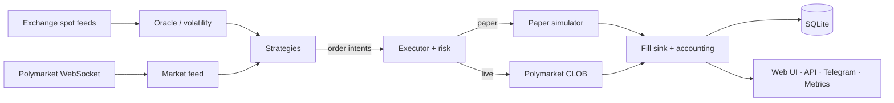

<div align="center">

# 🤖 Poly-bot

**A high-frequency trading bot for Polymarket crypto "up/down" markets, written in Rust.**

Real-time order books · deterministic paper simulator · live trading · risk controls · web dashboard · research toolkit


</div>

Poly-bot trades Polymarket's short-horizon binary markets on crypto prices (5-minute, 15-minute, hourly and longer "up/down" brackets on BTC, ETH, SOL, XRP and others). It streams order books from Polymarket and spot prices from several exchanges, runs pluggable strategies that can be switched on and off at runtime, and routes every order through a single executor that targets either a deterministic paper simulator or the live Polymarket CLOB.

> [!CAUTION]
> ## ⚠️ Disclaimer — read before using this software
>
> - **For research and educational purposes only.** This is not a product, a service or a recommendation of any kind.
> - **No financial, investment, legal or tax advice.** Nothing in this repository is an invitation to trade, buy or sell anything.
> - **Trading prediction markets and crypto assets is high-risk.** You can lose all the money you put in. Prices, fees, liquidity and market rules change without notice, and results differ from user to user.
> - **The software may contain bugs** that cause wrong orders, wrong accounting, lost funds or exposed credentials. Test thoroughly in paper mode before risking real money.
> - **Use entirely at your own risk.** The software is provided "AS IS", without warranty of any kind (see [LICENSE](LICENSE)). The authors and contributors accept **no liability** for any loss, damage or legal consequence arising from its use or misuse.
> - **You are solely responsible for complying** with Polymarket's terms of service, the rules of every venue or data provider you connect to, and the laws and regulations that apply where you live, including any restrictions on who may access prediction markets. Do not use this software to circumvent such restrictions.
> - **Not affiliated with Polymarket**, Chainlink, Binance or any other company mentioned here. All trademarks belong to their owners.
> - **Never commit or share your private keys or API credentials.**
>
> If you do not accept these terms, do not use this software.

> [!NOTE]
> **Project status:** this project is closed. There is no further development, no support and no roadmap. Issues and pull requests may not be answered.

---

## ✨ Features

| | |
|---|---|
| ⚡ **Low-latency core** | Async Rust (Tokio): Polymarket market and user WebSockets, multi-exchange spot feeds, Chainlink price streams |
| 🧪 **Paper & live modes** | One switch in `.env`. Paper mode fills against real L2 depth with latency, FOK rejection and a queue model, fully reproducible |
| 🎯 **Single order path** | Strategies emit intents; one executor applies risk checks and submits to the simulator or the live CLOB |
| 🛡️ **Risk controls** | Global and per-strategy kill switches, rate limits, daily loss stops, global exposure cap, per-bracket limits, cooldowns |
| 🧮 **Exact accounting** | `Decimal` arithmetic, integer micro-USDC in SQLite, fees, partial fills, redemptions and settlement PnL |
| 🔁 **Order reconciliation** | Uncertain submits are journaled and reconciled; orphan legs and unsettled positions are handled automatically |
| 🔌 **Hot-toggleable strategies** | Enable or disable any strategy at runtime from the UI, the HTTP API or Telegram; changes persist to its TOML |
| 📊 **Observability** | React web dashboard, JSON API, Prometheus metrics, Telegram notifications and commands |
| 🔬 **Research toolkit** | Causal event tape, offline replay through the real execution pipeline, backtesting, Python analysis tools |

## 🏗️ How it works



More detail in [docs/ARCHITECTURE.md](docs/ARCHITECTURE.md).

## 🚀 Quick start

**Requirements:** Linux, a recent stable Rust toolchain, a C compiler, `cmake`, `pkg-config`. Node.js and `pnpm` to build the web UI once.

```bash
git clone https://github.com/KikeKnox/Poly-bot.git
cd Poly-bot

./launch.sh --check              # verify requirements
cargo build --release --locked   # build (target/release/poly-bot)
cargo test                       # run the test suite
./launch.sh                      # start in paper mode (default)
```

Then open the dashboard at **<http://127.0.0.1:8766/ui/>**. Prometheus metrics are served at `/metrics` on the same port.

### Configuration

```bash
cp .env.example .env                       # secrets and mode switches (never commit .env)
$EDITOR config/general.toml                # global settings
$EDITOR config/strategies/<strategy>.toml  # per-strategy settings
```

- **Paper mode** is the default. Starting balance: `paper_initial_deposit_usdc` in `config/general.toml`; add simulated funds with `POST /paper/deposit` and body `{"usdc":"1000"}`.
- **Live mode** is selected with `HRF_MODE=live` in `.env` (or `./launch.sh --live`) and needs your Polymarket credentials in `.env`. Strategies marked `paper_only = true` never run in live.
- Any config key can be overridden with an environment variable: `HRF_<SECTION>__<KEY>`.

Full reference: [docs/CONFIGURATION.md](docs/CONFIGURATION.md).

### Enabling a strategy

All strategies start disabled. Turn one on from the UI, from Telegram, by setting `enabled = true` in its TOML, or over the API:

```bash
curl -X POST http://127.0.0.1:8766/control/strategy \
     -H 'Content-Type: application/json' \
     -d '{"strategy":"arb_15m5m","enabled":true}'
```

## 🧠 Strategies

Each strategy is an independent task that reads order-book snapshots and emits order intents. Configure them in `config/strategies/<name>.toml`.

| Strategy | Idea |
|---|---|
| `arb` | Taker parity arbitrage: buy YES and NO when the two asks sum below 1 after fees |
| `arb_15m5m` | Basket of a 15m and a 5m market that close together, ordered by their strikes, so the basket pays at least 1 |
| `directional` | Enter when a fair-value model disagrees with the ask |
| `near_certain` | Buy the near-winning side when its z-score is high |
| `near_expiry` | Buy the winning side by spot distance in the final seconds |
| `market_making` | Quote bid and ask around fair value |
| `parity_maker` | Resting bids on both sides with a combined price below 1 |
| `drift_box` | Biased entry on the oracle-favored side plus a deferred parity box |
| `open_momentum` | Enter in the first seconds after a bracket opens |
| `theta_capture` | Maker bid on the near-winning side close to expiry |
| `follower` | Copy the entries of a configured wallet |
| `post_close_sweep` | Buy the determined winner after close, before the book corrects |
| `reward_farm` | Liquidity-rewards farming on reward-eligible markets |
| `g_rw1_maker` | Fixed-ticket maker for rewards markets |
| `model_btc5m` | Trade the probability of a numeric model on BTC 5-minute markets |
| `rl_predictor` | Reinforcement-learning policy over the model's probabilities |

## 🛠️ Helper scripts

| Script | Purpose |
|---|---|
| `launch.sh` | Build if needed and run the bot (`--check`, `--live`, `--help`) |
| `clean.sh` | Remove build output, caches, logs and local databases (asks before deleting) |
| `calibrate.sh [hours]` | Paper-mode calibration run with Prometheus metric snapshots |
| `deploy/install-service.sh` | Install a systemd service with automatic restart |

## 📁 Repository layout

```
src/                     Rust crate: library + poly-bot binary (module map in docs/ARCHITECTURE.md)
  bin/                   Auxiliary binaries: hrf_backtest, hrf_research_env, rl_policy_env, ws_probe
tests/                   Rust integration tests
config/                  general.toml, telegram.toml, strategies/<name>.toml
web/                     React + Vite + TypeScript dashboard
deploy/                  systemd unit and installer
docs/                    Architecture, configuration and portability notes
tools/research_tools/    Python verification, calibration and inventory tools
tools/rl_predictor/      Python RL policy contract, trainer and fixtures
research/numeric_model/  Python causal dataset builder and baseline model trainer
paper_rl/                Isolated profile for RL paper runs
```

## 📚 Documentation

- [Architecture](docs/ARCHITECTURE.md): data flow, modules, order lifecycle, simulator, risk, API
- [Configuration](docs/CONFIGURATION.md): configuration layers, overrides, paper and live modes
- [Portability](docs/PORTABILITY.md): moving the project to another machine
- [AGENTS.md](AGENTS.md): guide for AI coding agents working on this repository

## 📄 License

[MIT](LICENSE). Provided "as is", without warranty of any kind. See the disclaimer above.
