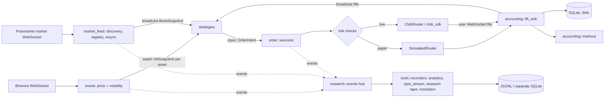
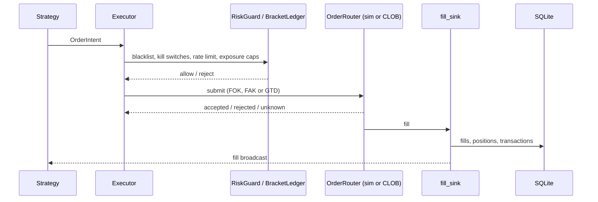

# Architecture

This document describes how the bot is put together: the data flow, the module map, the lifecycle of an order, the paper simulator, the risk controls, the API and the testing approach. For configuration see [CONFIGURATION.md](CONFIGURATION.md).

## 1. Data flow

Everything runs as asynchronous tasks on Tokio, started in `src/main.rs` and held in a `JoinSet`. Components talk through channels: `watch` for "latest value" data, `broadcast` for streams that several consumers read, `mpsc` for work queues.

In words:

1. **Feeds.** `oracle/` consumes Binance trade streams for several assets and publishes a price and an EWMA volatility snapshot per asset. `market_feed/` discovers Polymarket markets (by slug pattern or tag, per "universe"), keeps a registry of markets and tokens, subscribes to the market WebSocket and rebroadcasts normalized `BookSnapshot`s. A batched REST sweeper repairs books that did not arrive over the socket. Books older than `market_feed.max_book_age_ms` are not traded.
2. **Strategies.** Each enabled strategy is a task that reads the book broadcast (plus the oracle watches) and emits `OrderIntent`s. A `BracketLedger` (`coordination.rs`) lets only one strategy claim a bracket at a time and caps same-side net exposure.
3. **Executor.** `order/executor.rs` is the only place that sends orders. It applies the risk checks, then hands the order to an `OrderRouter`.
4. **Routers.** In paper mode the router is `SimulatedRouter`; in live mode it is `ClobRouter`, which signs and sends orders through the official Polymarket CLOB SDK (`clob_sdk.rs`). The choice is made once at startup from `Mode`.
5. **Fill sink.** Paper fills and live fills (from the user WebSocket) enter the same `accounting::fill_sink`, which deduplicates, updates `fills`, `positions` and `transactions` in SQLite and rebroadcasts the fill.
6. **Research hub.** Books, trades, spot ticks and order submits are also published to `research::events`, which the recorders in `tools/recorders/` write to disk. Recorders only observe; they use non-blocking `try_send`, so a slow disk drops research events instead of slowing trading.

## 2. Module map (`src/`)

| Module | Responsibility |
|---|---|
| `main.rs` | Wiring: loads config, builds the shared state, spawns every task, handles shutdown |
| `config.rs` | Layered configuration loading and startup validation (see [CONFIGURATION.md](CONFIGURATION.md)) |
| `types.rs`, `time.rs` | Shared types (`Mode`, `StrategyId`, `OrderIntent`, ...) and clock helpers |
| `state.rs` | SQLite persistence (sqlx, WAL). One store per mode; files are named `<stem>_<mode>.sqlite` so paper and live never share one |
| `risk.rs`, `coordination.rs` | Kill switches, rate limits, loss stops, cooldowns; per-bracket net exposure ledger |
| `fair_value.rs` | Pure functions only: `P(YES)` from spot, strike, volatility and time (no I/O, so the backtest can reuse it) |
| `market_feed/` | Market discovery, registry, REST resync, market and user WebSockets |
| `oracle/` | Binance price and volatility, turbulence index, liquidation feed, Chainlink TWAP source |
| `order/` | `executor`, the `OrderRouter` trait, `sim_router` (paper), `clob_router` (live) |
| `strategy/` | One file per strategy, a `registry`, and a `supervisor` that starts strategies enabled at runtime |
| `accounting/` | `fill_sink`, post-fill `markout`, `mark_price` |
| `settlement/` | `orphan` checker, on-chain `redeem`, `post_close` observer, `position_reconciler` (live) |
| `research/` | Event contract, causal tape producer (`events`), market labels |
| `tools/` | In-process tools that never emit orders (see section 7) |
| `api/` | axum HTTP server, bearer auth, handlers, the static UI |
| `telegram.rs` | Optional Telegram control |
| `backtest.rs`, `replay.rs`, `research_replay.rs`, `model_observer.rs` | Offline backtest, deterministic replay of the real pipeline, replay of the research tape, shadow evaluation of the numeric model |
| `rl/`, `strategy/rl_predictor.rs` | RL policy runtime (paper-only) |
| `bin/` | `hrf_backtest`, `hrf_research_env`, `rl_policy_env`, `ws_probe` |

## 3. Order lifecycle and accounting

The executor checks, in order: market blacklist, global kill switch, per-strategy kill switch, per-strategy rate limit, and (for buys) position and exposure limits including `risk.max_total_exposure_usdc`. It records which strategy owns each `(market, token)` pair so fills can be attributed, then delegates to the router. Two-leg orders (hedges, baskets) submit the second leg only if the first was accepted or filled.

**Uncertain orders.** If a submit gets no definite answer (a lost ACK, a timeout), the executor does not assume failure. The attempt is recorded in an "unknown" journal and later reconciled against the venue, so the book of record cannot silently diverge from the exchange. The paper simulator can inject this failure on purpose (`risk.paper_unknown_rate`) to exercise the path.

**Accounting.** Money is `rust_decimal::Decimal` in memory and integer micro-USDC (x1,000,000) in SQLite. Every fill goes through `fill_sink`, which inserts into `fills` idempotently, updates `positions` (open, average, close) and writes the `transactions` ledger used for PnL and the history views. `settlement/orphan.rs` periodically looks for positions whose market has closed, asks the CLOB for the winner and books the settlement PnL (won: `size * 1 - cost`, lost: `-cost`); if resolution is still pending it retries on the next cycle. In live mode it can redeem on-chain first (`[redeem]` section). `accounting/markout.rs` records the mid price 5 s and 30 s after each fill as an adverse-selection metric.

## 4. The paper simulator

`order/sim_router.rs` is designed so that paper results do not flatter the strategy:

- **Depth-aware fills.** Takers walk the recorded L2 book instead of filling at the touch; there is no fill without a book.
- **Latency and rejection.** The router waits `paper_latency_ms` before evaluating; a FOK is rejected if the price moved against it or depth is insufficient. A residual random rejection rate (`risk.paper_fok_fill_rate`, overridable per strategy) models liquidity that the snapshot cannot show.
- **Queue model for resting orders.** A GTD order joins behind the displayed size at its price level and becomes fill-eligible only after evidence of consumption (the displayed size shrinking, trades crossing the level, our own takers taking depth).
- **Slippage and correlated legs.** `risk.paper_slippage_bps` and `risk.paper_pair_fill_correlation` control slippage and how correlated the two legs of a pair are.
- **Determinism.** Randomness is seeded, so the same tape and configuration give the same result. `replay.rs` drives a recorded tape through the production strategy, executor, risk guard and simulator into an in-memory SQLite, and `backtest.rs` offers a simpler diagnostic mode.

## 5. Risk controls

`risk.rs` provides the `RiskGuard` used by the executor:

- global kill switch and per-strategy kill switches (togglable from the API and Telegram);
- per-strategy `max_orders_per_hour` and `daily_loss_usdc_stop` (realized PnL only);
- global `max_total_exposure_usdc` (open positions plus resting orders) and optional `max_bracket_usdc` net directional cap per bracket;
- entry cooldowns after losing exits (`entry_cooldown_secs`, `loss_strike`, `loss_strike_cooldown_secs`), which block buys only, never sells or cancels;
- in paper mode `paper_disable_kill_switch = true` (default) lets calibration runs continue through simulated losses.

On top of these sit the startup barriers in `config.rs` that make live trading fail closed: a strategy must be `enabled` and not `paper_only` to run in live; live startup is refused if `HRF_MODE=live` contradicts `config/general.toml`, if a live-capable (non-`paper_only`) strategy has no daily loss stop, or if on-chain redemption has no RPC URL. Some strategies (`model_btc5m`, `rl_predictor`, `theta_capture`) are structurally paper-only.

## 6. API and UI

`src/api/` serves JSON endpoints, the Prometheus text at `/metrics` and the React single-page app from `src/api/static/dist/` (built from `web/`) on one port (default 8766, bound to loopback).

- Diagnostics: `GET /healthz`, `/status`, `/metrics`, `/recent`, `/settings`.
- Control (`POST`): `/control/strategy` (toggle a strategy or tool), `/control/strategy_limits`, `/control/exposure_limit`, `/control/kill`, `/control/kill_switches`, `/control/strategy_kill`, `/control/blacklist`, `/control/shutdown`.
- Account and PnL: `GET /paper/account`, `/paper/pnl`, `/paper/positions`, `/pnl_strat`; `POST /paper/deposit`.
- UI data: `GET /ui/strategies`, `/ui/tools`, `/ui/history`, `/ui/pnl_series`, `/ui/risk`, `/ui/market_health`, `/ui/alerts`, `/ui/transactions`, and others (see `src/api/mod.rs`).

Authentication is a bearer token compared in constant time (`api/auth.rs`). With a token configured, every endpoint except `/healthz` and `/metrics` requires it. With an empty token, paper mode is open (acceptable on loopback); in live mode everything except `/paper/*` answers 503. Startup refuses a non-loopback `api.bind` without a token. The static UI files are public by construction.

Telegram (`telegram.rs`) offers the same controls as chat commands: `/state`, `/positions`, `/pnl`, `/logs`, `/mute`, `/kill`, `/reset`, `/enable`, `/disable`, `/limits`, `/exposure`, `/help`. Only the user IDs in `TELEGRAM_ALLOWED_IDS` are served.

## 7. Strategies versus tools

- A **strategy** (`src/strategy/`, identified by `StrategyId`) can emit `OrderIntent`s, so it goes through the executor and `RiskGuard`. Strategies enabled at boot are spawned in `main.rs`; those enabled later are started by `strategy/supervisor.rs`. The toggle is persisted to `config/strategies/<name>.toml` with `toml_edit`, preserving comments, via a temporary file and atomic rename.
- A **tool** (`src/tools/`, identified by `ToolId`) never emits orders and does not pass through `RiskGuard`. Tools are started and stopped by `ToolSupervisor`, with the same hot toggle. They are `vol_surface` and `ladder_arb` (scanners), the recorders `analytics`, `spot_stream`, `research_events` and `resolution_fetcher`, and `model_tool` (publishes P(YES) from a small versioned model). Recorders are stopped with a signal plus join so they flush, never with `abort`, and start before the oracle and market feed so no early event is lost.

## 8. Testing approach

- **Unit tests** live next to the code in `src/` (`#[cfg(test)]`); `cargo test --lib` runs them.
- **Integration tests** in `tests/*.rs` cover the order pipeline end to end against the simulator, fill accounting, order uncertainty and its persistence, orphan settlement, replay, the research tape and labels, and the HTTP API including authentication. Fixtures are in `tests/fixtures/`.
- **Tests build their own wiring** (supervisors with dummy channels, in-memory SQLite) and run offline; none needs network access or credentials.
- `cargo check --locked --offline --all-targets` compiles the library, binaries and every test; use it after changing a signature in `src/`, because `cargo build` does not compile `tests/`.
- `tests/test_portable_scripts.py` exercises `launch.sh` and `clean.sh` in isolated fixtures. The Python tools have their own `unittest` suites (see the README).
